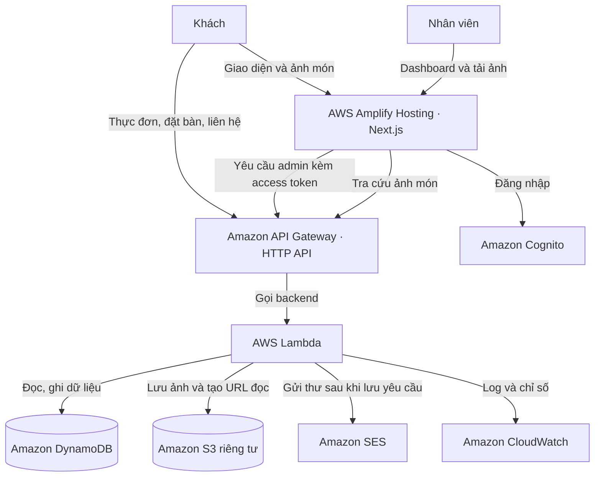

# AUREL · Dining & Wine

AUREL là website nhà hàng mẫu, từ xem thực đơn và không gian đến gửi yêu cầu đặt bàn. Nhân viên có trang quản trị riêng để xử lý yêu cầu, cập nhật giá và thêm món cùng ảnh. Ứng dụng dùng Next.js, React, TypeScript và Tailwind CSS, với backend serverless trên AWS.

[Web demo](https://main.d2rkhtb7c0k5r7.amplifyapp.com/) · [Hướng dẫn kỹ thuật](docs/guide.md) · [Bản phát hành](https://github.com/ndthuy21/aurel-restaurant/releases)

## Có thể làm gì?

| Khu vực | Tính năng |
| --- | --- |
| Thực đơn | 100 món Việt mẫu có ảnh. Tìm theo tên có dấu hoặc không dấu, lọc theo nhóm và món chay. |
| Không gian | Xem và phóng to ảnh không gian, món ăn và chi tiết trang trí. |
| Đặt bàn | Chọn ngày, giờ, số khách và nhận mã yêu cầu sau khi lưu. Nhà hàng xác nhận bàn riêng. |
| Quản trị | Quản lý thực đơn, bật hoặc ẩn món, xác nhận hoặc hủy yêu cầu đặt bàn và xem lời nhắn. |

Để đăng món mới, vào **Quản trị → Thực đơn → Thêm món**. Điền thông tin, chọn ảnh thu nhỏ trong thư viện hoặc tải ảnh **JPG, PNG, WebP tối đa 2 MB**. Xem trước, bật **Đang phục vụ** và bấm **Lưu món ăn**. Món đang phục vụ sẽ xuất hiện trên thực đơn công khai.

## Chạy trên máy

Cần **Node.js 22.13+** và **pnpm 11.25.0**. Chạy các lệnh sau trong thư mục repository:

```sh
pnpm install --frozen-lockfile
pnpm setup
pnpm dev
```

Mở [website local](http://127.0.0.1:3000/) hoặc [trang admin local](http://127.0.0.1:3000/admin). Dùng email `admin@aurel.local` và mật khẩu `LOCAL_ADMIN_PASSWORD` trong tệp `.env.local` do lệnh setup tạo. Chế độ local có sẵn món mẫu và lưu dữ liệu thử trong `.data/`.

## Kiến trúc AWS



API Gateway xác thực token quản trị, sau đó Lambda kiểm tra nhóm `admin`. Khi đặt bàn, DynamoDB lưu yêu cầu và cập nhật sức chứa trong cùng một giao dịch. Với ảnh tải lên, trình duyệt đọc tệp từ S3 qua URL ký có thời hạn.

## Triển khai

1. Build Lambda bằng `pnpm build:lambda` và triển khai backend theo mẫu [AWS SAM](infra/template.yaml).
2. Lấy thông số từ CloudFormation, nạp thực đơn mẫu và tạo người dùng thuộc nhóm `admin` trong Cognito.
3. Kết nối repository với Amplify bằng [amplify.yml](amplify.yml), điền biến cấu hình và cập nhật `FrontendOrigin` để API Gateway và S3 nhận đúng origin.

[Hướng dẫn AWS đầy đủ](docs/guide.md#4-triển-khai-aws-backend) có lệnh từng bước, biến môi trường và quy trình dọn tài nguyên.

## Kiểm thử

```sh
pnpm check
pnpm build
pnpm test:smoke
```

`pnpm check` kiểm tra TypeScript, chạy bộ test và build gói Lambda. Smoke test chạy trên bản production cục bộ và thử các luồng như đăng nhập, lưu đặt bàn và tải ảnh món.

## Lưu ý khi dùng demo và triển khai

- **Dữ liệu demo:** Thực đơn, giá và thông tin nhà hàng là dữ liệu mẫu. Dùng thông tin giả khi thử form đặt bàn.
- **Email SES:** Mã yêu cầu cho biết hệ thống đã tiếp nhận. Nhân viên xác nhận bàn trong dashboard. Khi SES còn ở sandbox, hãy dùng địa chỉ đã xác minh hoặc SES mailbox simulator. Lỗi gửi thư không làm mất yêu cầu đã lưu.
- **Cấu hình:** Dùng `.env.local` cho dữ liệu và tài khoản thử trên máy. Khi triển khai AWS, cập nhật đúng `FrontendOrigin`, dùng tài khoản admin Cognito và giữ thông tin đăng nhập ngoài repository.

## Giấy phép và nguồn ảnh

Mã nguồn dùng giấy phép [MIT](LICENSE). Ảnh tư liệu có giấy phép riêng theo từng tệp. [Nguồn ảnh món ăn](PHOTO-CREDITS.md) · [Nguồn ảnh không gian](SPACE-PHOTO-CREDITS.md)
