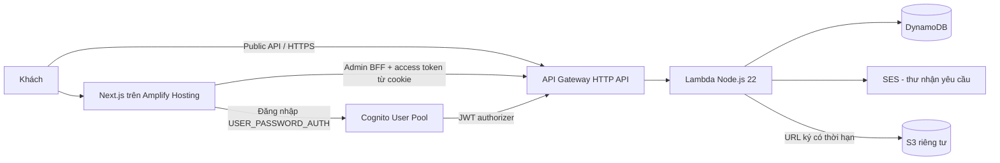

# AUREL · Dining & Wine

Website nhà hàng minh họa, thiết kế riêng theo phong cách dark/gold. Next.js **15.5.28**, React 19, TypeScript, Tailwind CSS. Tên, địa chỉ và giá món là dữ liệu mẫu; thực đơn có 100 món với ảnh tư liệu thật từ Wikimedia Commons (nguồn và giấy phép tại từng món), không gian sử dụng 8 ảnh tư liệu thật có ghi nguồn; không sao chép nội dung, ảnh, video, logo hoặc đánh giá từ godrestaurant.com.

Repository chứa mã nguồn và cấu hình triển khai AUREL. Các bước dựng backend AWS và kết nối Amplify với GitHub nằm ở mục 4–7.

## 1. Chạy trên máy

Cài Node.js **22.13 trở lên** và pnpm **11.25.0**. Nếu máy chưa có pnpm, dùng Corepack (`corepack enable`, `corepack prepare pnpm@11.25.0 --activate`) hoặc cài pnpm theo tài liệu chính thức. Nếu Node không kèm Corepack, có thể cài Corepack bằng npm trước.

```sh
cd aurel-restaurant
pnpm install --frozen-lockfile
pnpm setup
pnpm dev
```

Mở **http://127.0.0.1:3000**. `pnpm setup` tạo `.env.local` với mật khẩu và khóa phiên ngẫu nhiên, không ghi đè file đã có.

- Quản trị: **http://127.0.0.1:3000/admin**.
- Email: `admin@aurel.local`. Mật khẩu: trường `LOCAL_ADMIN_PASSWORD` trong `.env.local` trên máy của bạn.
- Đổi email/mật khẩu local trong `.env.local`, rồi khởi động lại ứng dụng. Không đưa file này vào Git.
- Dữ liệu local nằm trong `.data/aurel.json`; tự khởi tạo 100 món mẫu khi truy cập backend lần đầu. Đặt bàn và lời nhắn ban đầu trống.
- Local adapter chỉ dành cho **một tiến trình trên máy**. Không dùng file JSON làm database cho Amplify/Lambda hay nhiều replica.

Kiểm tra bản build tối ưu:

```sh
pnpm check          # TypeScript, unit/integration tests, bundle Lambda + seed
pnpm build
pnpm test:smoke     # server riêng ở 3100, dữ liệu tạm, tự dọn sau khi chạy
pnpm start
```

Port 3000 phải trống để chạy web; 3100 phải trống cho smoke test. Trên Windows, chạy các lệnh này bằng terminal có Node và pnpm trong PATH. Không phụ thuộc font hoặc ảnh bên ngoài để chạy giao diện.

## 2. Chức năng

| Khu vực                | Hoạt động                                                                                                  |
| ---------------------- | ---------------------------------------------------------------------------------------------------------- |
| Trang chủ `/`          | Hero, câu chuyện, món gợi ý, trải nghiệm, đặt bàn                                                          |
| Thực đơn `/menu`       | Đọc 100 món từ API, lọc nhóm, tìm không dấu, lọc món chay, phân trang 12 món; chỉ hiện món đang phục vụ    |
| Gallery `/gallery`     | 12 ảnh thật về không gian/chi tiết/món Việt, lọc nhóm, phóng lớn bằng dialog, phím ← → và Escape           |
| Giới thiệu `/about`    | Câu chuyện thương hiệu minh họa                                                                            |
| Liên hệ `/contact`     | Lưu lời nhắn qua backend, kiểm tra dữ liệu và đồng ý liên hệ                                               |
| Đặt bàn `/reservation` | Kiểm tra ngày/giờ, 1–8 khách, trước ít nhất 30 phút, tối đa 90 ngày; nhận mã yêu cầu                       |
| Admin `/admin`         | Đăng nhập, thống kê từ dữ liệu thật, tìm/lọc đặt bàn, xác nhận/hủy, CRUD thực đơn, đọc lời nhắn, đăng xuất |
| Media admin            | Chế độ AWS: upload JPEG/PNG/WebP lên S3 riêng tư bằng URL ký, xem trước 15 phút                            |

Đặt bàn mới là **yêu cầu chờ xác nhận**. Thông báo gửi thành công không đồng nghĩa bàn đã được xác nhận. Không có thanh toán hoặc đặt bàn tại nhà hàng ngoài đời thực.

## 3. Kiến trúc



**Local:** trình duyệt → Next Route Handler `/api/*` → cùng service layer → FileStore.

**AWS:** public menu/booking/contact gọi trực tiếp API Gateway qua `NEXT_PUBLIC_API_BASE_URL` để API nhận IP kết nối thực tế; admin gọi BFF Next `/api/admin/*`. BFF lưu Cognito access token trong cookie `HttpOnly`, `SameSite=Strict`, `Secure` trên production, không lưu token vào localStorage. BFF gửi token đến API Gateway. Gateway kiểm tra chữ ký, issuer, client audience và thời hạn; Lambda còn yêu cầu `token_use=access` và nhóm chính xác `admin`.

Đăng nhập Cognito được thực hiện từ Next server bằng public app client, không cần AWS access key trong frontend. Không có chế độ tự đăng ký admin. Chế độ `aws` không tự chuyển sang local khi cấu hình lỗi.

## 4. Triển khai AWS backend

Cần tài khoản AWS, AWS CLI v2, AWS SAM CLI, quyền CloudFormation/IAM/DynamoDB/S3/Cognito/SES/Lambda/API Gateway, và Node/pnpm. Ví dụ dưới dùng `ap-southeast-1`. AWS có thể tính phí theo tài nguyên/lưu lượng; cấu hình này không phải cam kết nằm trong Free Tier.

```sh
aws configure sso
aws sso login --profile YOUR_PROFILE
export AWS_PROFILE=YOUR_PROFILE
export AWS_REGION=ap-southeast-1
pnpm build:lambda
sam validate --lint --template-file infra/template.yaml
sam build --template-file infra/template.yaml
sam deploy --guided
```

Nếu stack tạo email identity SES mới, mở thư AWS gửi đến `SenderEmail` và bấm xác minh ngay trong lúc stack đang tạo. CloudFormation có thể chờ bước xác minh này. Không cần gửi mật khẩu/email token cho công cụ triển khai.

Ở lần deploy backend đầu:

- Stack name: `aurel-backend`.
- Region: `ap-southeast-1`.
- `FrontendOrigin`: `https://pending.invalid` nếu chưa có URL Amplify. Đây là origin tạm không hoạt động; cập nhật ở bước 7 trước khi thử trình duyệt.
- `SenderEmail`: **email thật thuộc quyền sở hữu của bạn**, không dùng `hello@aurel.example`.
- Cho phép tạo IAM roles khi SAM hỏi. Backend cần các public route `GET /menu`, `POST /reservations`, `POST /contact`; các route `/admin/{proxy+}` dùng JWT authorizer.
- SAM deploy guided có thể cảnh báo các public route không có authentication: đó là các endpoint dành cho khách được khai báo chủ ý trong template.

Lấy outputs:

```sh
aws cloudformation describe-stacks --stack-name aurel-backend \
  --query 'Stacks[0].Outputs' --output table
```

Outputs gồm `ApiUrl`, `TableName`, `MediaBucket`, `UserPoolId`, `CognitoClientId`. Không tự tạo tên tài nguyên thay cho outputs thực tế.

### Nạp thực đơn AWS

```sh
export TABLE_NAME=YOUR_TABLE_OUTPUT
node dist/seed-aws.mjs
```

Script chỉ thêm các ID chưa tồn tại; không ghi đè món đã chỉnh. Có thể chạy lại. Trước khi seed, API AWS trả thực đơn trống đúng với database mới.

Nếu nâng cấp từ đúng tám món demo ban đầu lên bộ 100 món, chạy kế hoạch và xem trước rồi áp dụng:

```sh
node dist/replace-demo-menu.mjs          # Chỉ đọc, in kế hoạch
node dist/replace-demo-menu.mjs --apply  # Sao lưu menu vào .data trước khi áp dụng
```

Script chỉ tác động partition `menu`, giữ các món trong catalog đã tồn tại, và từ chối menu có ID tùy chỉnh hoặc tên món demo đã đổi. Nó chèn các món mới theo transaction, sau đó gỡ tám món demo bằng điều kiện dữ liệu chưa thay đổi. Không sửa đặt bàn/lời nhắn. Nếu bước sau lỗi, có thể còn 108 món tạm thời; đọc lỗi rồi chạy lại. Thư mục `.data` không đưa vào source hoặc artifacts.

Ảnh được tải sẵn, thu nhỏ và chuyển WebP; trình duyệt không gọi Wikimedia. Không xóa nguồn/tác giả/giấy phép khi sử dụng lại ảnh. Chỉ dấu “CHAY” cho biết công thức mẫu, không thay cho xác nhận nguyên liệu và nước chấm khi vận hành thực tế.

## 5. Tạo admin Cognito

Script sau dùng AWS credentials của bạn, nhập mật khẩu ẩn trong terminal, tạo user không gửi thư mời, đặt permanent password và thêm group `admin`:

```sh
export USER_POOL_ID=YOUR_POOL_OUTPUT
export ADMIN_EMAIL=YOUR_REAL_EMAIL
node scripts/create-admin.mjs
```

Mật khẩu ít nhất 14 ký tự với hoa/thường/số/ký hiệu. Script từ chối ghi đè tài khoản đã có. Nếu bước đặt mật khẩu/thêm nhóm thất bại sau khi user đã được tạo, hoàn tất bằng Cognito Console/CLI; không chạy lại để đặt lại mật khẩu ngoài ý muốn. Script không tự đánh dấu email verified; xác minh quyền sở hữu trước khi bật khôi phục tài khoản qua email.

Bạn cũng có thể tự tạo user, đặt **permanent password** bằng `admin-set-user-password` và thêm vào group `admin` qua AWS CLI. Tránh truyền mật khẩu trực tiếp trong dòng lệnh/history; dùng file `--cli-input-json` được bảo vệ hoặc script ở trên. Không đưa mật khẩu vào Git.

Không đăng nhập bằng temporary password: giao diện hiện tại chưa triển khai challenge `NEW_PASSWORD_REQUIRED`/MFA. Nếu bật MFA, cần bổ sung màn hình xử lý challenge trước khi dùng.

## 6. SES

Template tạo email identity cho `SenderEmail`; mở thư AWS và xác minh địa chỉ. Trong SES sandbox, **cả người gửi và người nhận thử nghiệm** phải được xác minh (hoặc dùng địa chỉ SES mailbox simulator). Để gửi cho khách thực, cần được AWS cấp production access cho SES tại cùng region.

Sau khi lưu yêu cầu mới, Lambda cố gửi thư nhận yêu cầu. Thư nói rõ đang chờ xác nhận. Nếu SES lỗi, yêu cầu vẫn được lưu, API vẫn báo đã nhận, và lỗi gửi thư được ghi ở CloudWatch bằng mã yêu cầu, không ghi nội dung/địa chỉ email. Không có email local, không gửi email khi đổi trạng thái, không có queue/retry email hay đảm bảo giao thư. Đây là chủ ý của bản mẫu, cần outbox/SQS nếu vận hành giao thư tin cậy.

## 7. Amplify Hosting

Đẩy **nội dung thư mục này làm gốc một repository của bạn**. Không đẩy `node_modules`, `.next`, `.env.local`, `.data`, `dist`, `.aws-sam`.

### Cách dùng Console

Amplify → Create new app → kết nối repository/branch. Chọn Node 22 trong build image. Repository đã có `amplify.yml`.

Thêm các biến sau trước khi build; không thêm AWS access keys:

| Biến                       | Giá trị                                                 |
| -------------------------- | ------------------------------------------------------- |
| `DATA_MODE`                | `aws`                                                   |
| `API_BASE_URL`             | `ApiUrl` của backend                                    |
| `NEXT_PUBLIC_API_BASE_URL` | cùng `ApiUrl`, không dấu `/` cuối                       |
| `COGNITO_CLIENT_ID`        | `CognitoClientId`                                       |
| `COGNITO_USER_POOL_ID`     | `UserPoolId`                                            |
| `APP_AWS_REGION`           | `ap-southeast-1`                                        |
| `APP_ORIGIN`               | origin HTTPS chính xác của frontend, không dấu `/` cuối |

Origin mặc định có dạng `https://main.APP_ID.amplifyapp.com`. Nếu Console đã chạy build trước khi bạn có origin/biến đầy đủ, điền biến rồi chạy lại build. `scripts/amplify-env.mjs` chỉ đưa cấu hình **không bí mật** được liệt kê vào `.env.production` để SSR đọc được. Không đưa `SESSION_SECRET`, `LOCAL_ADMIN_PASSWORD` hay token GitHub vào script hoặc artifacts.

### Cấu hình bằng mã

`infra/amplify.yaml` tạo Amplify App `WEB_COMPUTE`, branch, buildspec, biến cấu hình và IAM service role chỉ cho CloudWatch Logs của Amplify. Khi tạo stack, xác nhận khả năng tạo IAM role. Với cách dùng Console, cho phép Amplify tạo role ghi log mặc định. BFF không cần compute role truy cập DynamoDB/SES/S3 vì gọi qua API Gateway. Dùng CloudFormation Console → Create stack → upload file, điền repository, branch, outputs backend và GitHub token chỉ có quyền cần thiết cho repository. Token là tham số `NoEcho`, không nằm trong source. Bạn có thể kết nối qua Console bằng GitHub App thay vì dùng template token nếu muốn.

`APP_ORIGIN` được template đặt ở branch theo URL Amplify mặc định. Sau khi tạo app/branch, mở Amplify Console và chạy build đầu tiên nếu chưa tự chạy. Nếu đổi sang custom domain hoặc tên branch có dấu `/`, cần đặt lại `APP_ORIGIN` thành origin thực tế; cách dựng URL trong template dành cho tên branch đơn giản như `main`.

### Cập nhật CORS backend

Sau khi có origin Amplify thật, chạy lại backend deploy và thay **FrontendOrigin** bằng URL đó. Dùng lại stack/region/email đã chọn; lưu giá trị origin mới trong cấu hình SAM:

```sh
sam deploy --guided
```

Thao tác này cập nhật cả CORS API Gateway và S3. Redeploy frontend nếu thay đổi biến; `NEXT_PUBLIC_*` được đóng gói lúc build. Không sử dụng wildcard CORS cho admin. Các route BFF so `Origin` với `APP_ORIGIN`; API Gateway admin vẫn cần access token hợp lệ.

### Xác minh trên AWS sau deploy

1. `/menu` có 100 món sau seed; kiểm tra console Network không lỗi CORS.
2. Đặt bàn bằng email đã verify trong sandbox; xác minh bản ghi DynamoDB, thư SES và trạng thái `pending`.
3. Đăng nhập admin thuộc group; xác nhận đặt bàn, tải lại trang và đối chiếu database.
4. User không thuộc group và token hết hạn phải bị từ chối; public không đọc được danh sách đặt bàn/lời nhắn.
5. Thêm/sửa/ẩn/xóa món; trang menu phản ánh dữ liệu API.
6. Tải một ảnh thử qua tab S3; PUT thành công và preview hiển thị. Bucket không có public read. Ảnh upload chưa tự gắn vào gallery/menu; ảnh mẫu hiện tại là asset trong source. Upload mẫu bị lifecycle xóa sau 30 ngày.
7. Kiểm tra CloudWatch log của Lambda và build/SSR log của Amplify, không chỉ dựa vào thông báo frontend.

## 8. API

Local base `/api`; AWS base `ApiUrl`. Body/response JSON, lỗi `{ "error": "..." }`. Admin từ trình duyệt luôn qua `/api/admin/*`.

| Method | Path                         | Quyền        | Tác dụng                                               |
| ------ | ---------------------------- | ------------ | ------------------------------------------------------ |
| GET    | `/menu`                      | Public       | Món đang phục vụ                                       |
| POST   | `/reservations`              | Public       | Lưu yêu cầu, UUID idempotency, thử gửi SES             |
| POST   | `/contact`                   | Public       | Lưu lời nhắn                                           |
| POST   | `/auth/login`                | Chỉ Next BFF | Tạo cookie admin                                       |
| POST   | `/auth/logout`               | Chỉ Next BFF | Xóa cookie, thử GlobalSignOut trong AWS                |
| GET    | `/admin/session`             | Admin        | Kiểm tra quyền                                         |
| GET    | `/admin/reservations`        | Admin        | Danh sách đặt bàn                                      |
| PATCH  | `/admin/reservations/{uuid}` | Admin        | `{status: pending/confirmed/cancelled}`                |
| GET    | `/admin/contacts`            | Admin        | Danh sách lời nhắn                                     |
| GET    | `/admin/menu`                | Admin        | Cả món đang hiện và đã ẩn                              |
| POST   | `/admin/menu`                | Admin        | Tạo/cập nhật toàn bộ món theo ID                       |
| DELETE | `/admin/menu/{id}`           | Admin        | Xóa món                                                |
| POST   | `/admin/media`               | Admin, AWS   | `{contentType,size}` → URL PUT 2 phút, preview 15 phút |

Booking body ví dụ (ngày cần đổi cho phù hợp khi thử):

```json
{
  "id": "1cbbfe41-35a8-4a9e-a7c5-3e19773d890a",
  "name": "Khách mẫu",
  "email": "guest@example.com",
  "phone": "0901234567",
  "date": "2026-11-03",
  "time": "19:00",
  "guests": 2,
  "notes": "Không bắt buộc",
  "website": "",
  "consent": true
}
```

Trong local, POST/PATCH/DELETE phải gửi `Origin` chính xác, ví dụ `http://127.0.0.1:3000`. Mã HTTP: 400 dữ liệu sai, 401 chưa có quyền/phiên, 403 nguồn gửi hoặc group không hợp lệ, 404 không có route/record, 409 hết chỗ/xung đột, 413 body quá lớn, 429 quá nhiều yêu cầu, 500 lỗi hệ thống.

## 9. Mô hình dữ liệu và giới hạn

Một bảng DynamoDB khóa `pk` + `sk`:

- `menu` + ID món → `data` là MenuItem.
- `reservations` + UUID → `data` là yêu cầu và trạng thái.
- `contacts` + UUID → `data` là lời nhắn.
- `slots` + `YYYY-MM-DD#HH:mm` → bộ đếm `seats`.
- `limits` + SHA-256 → lượt gửi và TTL `expires`; key gồm time bucket nên TTL trễ không làm tiếp tục chặn bucket mới.

Tạo đặt bàn dùng transaction tăng số ghế có điều kiện và thêm UUID có điều kiện; không vượt 24 khách **trong cùng một khung giờ**. Hủy trả lại số ghế; mở lại kiểm tra sức chứa, thay đổi trạng thái có điều kiện chống ghi đè cạnh tranh. UUID lặp trả cùng mã, không thêm bản ghi hay gửi thư lại; khi đổi nội dung form sẽ tạo UUID mới. Một UUID đã dùng được coi là cùng yêu cầu, không dùng để sửa thông tin đặt bàn.

Đây là mô hình khung giờ độc lập: **chưa tính thời lượng dùng bữa, bàn cụ thể hoặc giao nhau giữa các khung giờ**, chưa có hủy/sửa từ phía khách. Pending vẫn giữ chỗ cho đến khi admin hủy. Ngày giờ được backend tính theo `Asia/Ho_Chi_Minh`.

Public API giới hạn 30 yêu cầu/IP/15 phút và 5/email/15 phút, cộng throttling toàn API Gateway. Có honeypot, giới hạn body 16 KB, validation backend và consent. Đây chưa phải giải pháp chống bot hoàn chỉnh. Local và Dynamo áp dụng cùng service; kiểm thử transaction Dynamo hiện dùng mock, chưa chạy cạnh tranh trên DynamoDB thật.

Phiên admin tối đa 1 giờ, không auto refresh, hết hạn cần đăng nhập lại. Login limiter ở BFF là bộ nhớ trên từng instance; Cognito còn có giới hạn riêng. JWT đã cấp có thể vẫn được API Gateway chấp nhận đến khi hết hạn ngay cả sau GlobalSignOut, vì Gateway xác minh JWT độc lập; không tuyên bố thu hồi tức thì. Local signout xóa cookie nhưng JWT đã bị đánh cắp vẫn có hiệu lực đến hạn. Nếu cần thu hồi tức thì, bổ sung denylist/custom authorizer.

Chưa có lịch đóng cửa, bảng giá thuế riêng, phân quyền nhiều cấp, MFA UI, audit history, xử lý yêu cầu xóa dữ liệu hay chính sách lưu dữ liệu khách. Dashboard tải hết dữ liệu (adapter có pagination Dynamo); cần API phân trang/lọc theo ngày khi quy mô tăng. S3 upload demo là tiện ích lưu tài sản riêng tư, chưa có pipeline tối ưu ảnh/quét file hoặc tích hợp quản lý gallery. Giữ cấu hình chặn index cho demo; thay domain `metadataBase`, `robots`, nội dung thật và pháp lý trước khi dùng thương hiệu thực.

## 10. Cấu trúc mã

```text
src/app/                 Trang Next App Router, BFF API
src/components/          Header/footer, form, tiêu đề trang
src/lib/                 Types, validation, dữ liệu mẫu, API client
src/server/              Service, FileStore/DynamoStore, auth, origin guard
src/aws/handler.ts       Lambda adapter + gate nhóm admin
infra/template.yaml     SAM: API, Lambda, DynamoDB, S3, Cognito, SES, log
infra/amplify.yaml      CloudFormation frontend Git-connected
amplify.yml             Build specification cho Amplify Console
public/images/          Ảnh WebP món ăn/không gian kèm nguồn ảnh; SVG dùng cho các phần minh họa khác
scripts/                Setup, bundle, seed AWS, env Amplify, HTTP smoke
tests/                 Unit/service/auth/capacity/Dynamo mock/Lambda tests
```

## 11. Dọn tài nguyên AWS

Xóa Amplify app khi không sử dụng; xóa backend stack bằng `sam delete --stack-name aurel-backend`. **DynamoDB và S3 có Retain** để tránh mất dữ liệu ngoài ý muốn, nên vẫn tồn tại và có thể tính phí sau khi xóa stack. Sau khi sao lưu và xác nhận không cần dữ liệu, xóa thủ công bảng và bucket (dọn object trước). LogGroup/SES identity/Cognito trong stack không được Retain. Kiểm tra CloudFormation deletion events để biết tài nguyên nào còn lại.

## Tài liệu đối chiếu

- [Amplify hỗ trợ Next.js SSR](https://docs.aws.amazon.com/amplify/latest/userguide/ssr-amplify-support.html): nhánh 15 được chọn theo phạm vi hỗ trợ công bố khi xây dựng.
- [Biến môi trường SSR trên Amplify](https://docs.aws.amazon.com/amplify/latest/userguide/ssr-environment-variables.html).
- [HTTP API JWT authorizer](https://docs.aws.amazon.com/apigateway/latest/developerguide/http-api-jwt-authorizer.html).
- [AWS SAM HttpApi](https://docs.aws.amazon.com/serverless-application-model/latest/developerguide/sam-resource-httpapi.html).
- [Next.js installation](https://nextjs.org/docs/app/getting-started/installation).

Mã nguồn và artwork SVG gốc được cấp phép MIT. Ảnh món ăn giữ giấy phép riêng CC BY/CC BY-SA/CC0/public domain theo từng ảnh; xem `PHOTO-CREDITS.md`, `SPACE-PHOTO-CREDITS.md` và các tệp `credits.json` tại `public/images/`. Phông Noto giữ giấy phép SIL OFL tại `src/assets/fonts/OFL.txt`. Thư viện bên thứ ba giữ giấy phép tương ứng. Xem `LICENSE`.

### Ghi chú phiên bản thư viện

`pnpm-workspace.yaml` cố định PostCSS đã vá trong toàn bộ dependency tree, bao gồm bản Next.js sử dụng. Zod dùng nhánh 4.6.7. Giữ override khi cập nhật lockfile; chạy lại audit, kiểm thử và build khi đổi phiên bản. Kết quả audit tại thời điểm bàn giao không phải bảo đảm không có lỗ hổng mới trong tương lai.

## Phương án triển khai qua AWS CodeCommit

Không cần token GitHub. Phương án này dùng `infra/artifacts.yaml` tạo bucket artifact, template backend được đóng gói bằng AWS CLI, rồi `infra/amplify-codecommit.yaml` tạo repository từ source ZIP và kết nối Amplify bằng IAM service role giới hạn trong repository đó.

Sau khi đăng nhập AWS CLI (có thể dùng `aws login --profile aurel --region ap-southeast-1` với AWS CLI v2.32+ và phiên Console), cấu hình profile/region rồi thực hiện:

```sh
export AWS_PROFILE=aurel
export AWS_REGION=ap-southeast-1
pnpm build:lambda
aws cloudformation deploy --stack-name aurel-artifacts --template-file infra/artifacts.yaml
```

Lấy `BucketName` từ outputs stack artifact. Đóng gói backend bằng `aws cloudformation package --template-file infra/template.yaml --s3-bucket YOUR_ARTIFACT_BUCKET --s3-prefix lambda --output-template-file ../packaged-backend.yaml`, rồi deploy file đã đóng gói với `CAPABILITY_IAM CAPABILITY_AUTO_EXPAND` và các tham số `FrontendOrigin`, `SenderEmail`. Nạp menu và tạo admin theo các mục tương ứng trong tài liệu này.

Tạo source ZIP sạch bằng `python3 scripts/package-source.py --output ../aurel-codecommit-source.zip`; tải ZIP lên bucket artifact. Template `infra/amplify-codecommit.yaml` nhận `SourceBucket`, `SourceKey`, `ApiUrl`, `CognitoClientId`, `CognitoUserPoolId` và tùy chọn `BranchName`. Deploy template này với `CAPABILITY_IAM`. Source ZIP phải chứa package.json ngay gốc, không có thư mục bọc ngoài.

Sau khi có `FrontendOrigin`, cập nhật tham số CORS backend thành origin thật và chạy `aws amplify start-job --app-id APP_ID --branch-name main --job-type RELEASE`. Khi sửa source trong CodeCommit, build lại theo pipeline hoặc lệnh này. Tham số `Code.S3` của repository trong CloudFormation chỉ nạp code ở lần tạo đầu; các cập nhật tiếp theo dùng Git hoặc CreateCommit.

### Ảnh không gian

Trang Không gian dùng 8 ảnh tư liệu thực của nhiều địa điểm khác nhau, phối cùng 4 ảnh món Việt lấy từ cùng catalog 100 món. Không gắn các địa điểm này với một nhà hàng AUREL có thật. Nguồn, tác giả và giấy phép được hiển thị ở trang `/gallery#photo-credits`, trong lightbox và tại `SPACE-PHOTO-CREDITS.md`. Có bản WebP nhỏ 640px cho grid và bản lớn tối đa 1600px cho lightbox/nền; ảnh tải từ hosting của website. Trang chủ và Giới thiệu dùng cùng bộ ảnh, dẫn về phần ghi nguồn.
